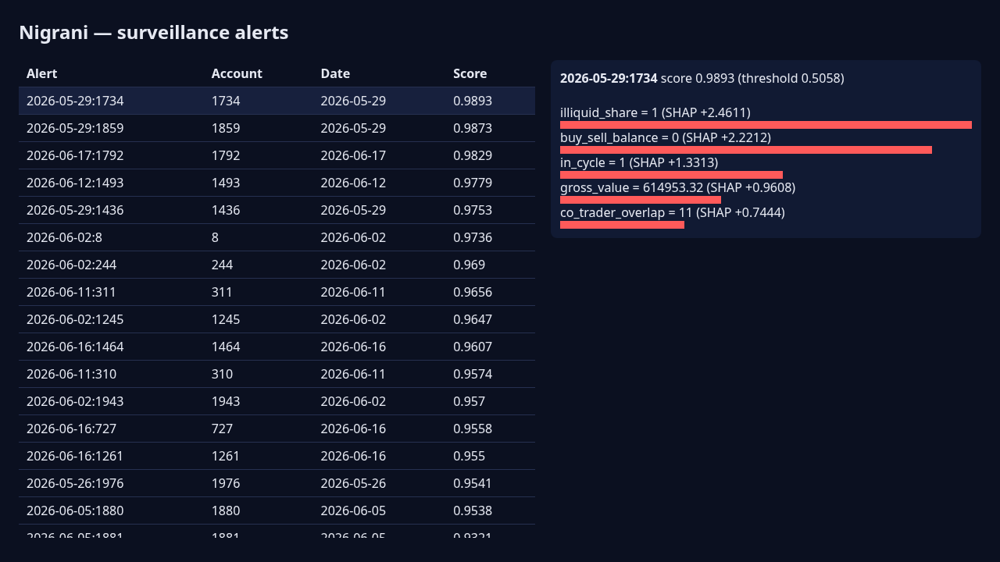
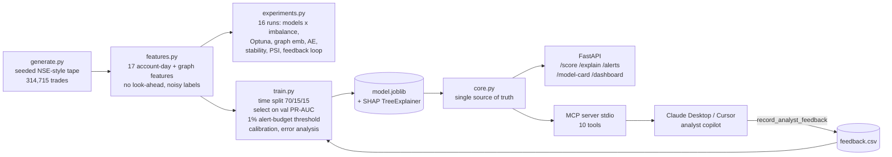

# Nigrani — explainable trade surveillance & AML copilot for a stockbroker


*Nigrani* (निगरानी) means "surveillance". It is the system a broker's compliance desk needs: score every **client account-day** for **wash trades, circular trading rings and pump-and-dump**, rank the alerts within the review capacity the team actually has, explain each one with SHAP, and let an analyst investigate through an **MCP server** from Claude Desktop or Cursor.

> The model decides the score. The LLM only fetches, explains and drafts. A human files.



## Architecture


## Quickstart
```bash
python3 -m venv .venv && .venv/bin/pip install -r requirements.txt
make all        # generate → features → experiments → train → tests (≈2 min on a laptop)
make serve      # API docs: http://localhost:8000/docs · dashboard: http://localhost:8000/dashboard
make mcp        # MCP server over stdio
make lint       # ruff
```
Claude Desktop / Cursor MCP config:
```json
{"mcpServers":{"nigrani":{"command":"/ABS/PATH/.venv/bin/python","args":["-m","nigrani.mcp_server"],"cwd":"/ABS/PATH"}}}
```
Docker: `docker build -t nigrani . && docker run -p 8000:8000 nigrani`. The Dockerfile is written but **I haven't built it**, because there's no Docker daemon on the build machine. CI runs lint, the pipeline and the tests.

## Data and why it's synthetic
Real broker client trades are confidential. The public labelled AML sets (IBM AMLworld, Elliptic) cover bank transfers and Bitcoin, not exchange trades. `generate.py` therefore builds a **seeded** tape: 2,000 accounts, 60 symbols, 120 trading days, 314,715 trades. Its typologies follow those in SEBI enforcement orders.

| Manipulative (label 1) | Legitimate look-alikes (label 0) |
|---|---|
| wash trades between linked accounts (710 trades) | family/HUF account crosses (5,726) |
| circular rings of 3–5 accounts (654) | prop-desk / market-maker crosses (7,052) |
| classic pump-and-dump, 5-day accumulate→dump (255) | legit 3-way family rebalancing that *forms a cycle* (246) |
| **subtle** pump-and-dump, 2–4 accounts, small size, mixed with normal trades (191) | news-driven crowd buying of an illiquid scrip (255), block trades (902) |

**Label noise:** the model trains on noisy labels, with 8% of true cases missed by analysts and 0.2% of normal cases mis-tagged. Validation and test are scored on the true labels. 1.16% of account-days are positive.

## Results (test = last 15% of trading days: 7,341 account-days, 77 positives)
Deployed: **CatBoost**, the best validation PR-AUC among the untuned models (see the design decisions below).

| Model (train/train.py) | Val PR-AUC | **Test PR-AUC** | Test ROC-AUC | Recall @1% alerts | Precision@100 |
|---|---:|---:|---:|---:|---:|
| Prior baseline | 0.012 | 0.011 | 0.500 | 0.000 | 0.00 |
| Logistic regression (balanced) | 0.867 | 0.755 | 0.984 | 0.701 | 0.62 |
| Random forest (balanced_subsample) | 0.918 | 0.808 | 0.983 | 0.766 | 0.67 |
| **CatBoost** | **0.923** | **0.833** | 0.983 | **0.792** | 0.68 |
| LightGBM unweighted | 0.862 | 0.799 | 0.972 | 0.753 | 0.64 |
| LightGBM scale_pos_weight | 0.853 | 0.819 | 0.959 | 0.766 | 0.65 |
| Isolation Forest (unsupervised) | 0.359 | 0.203 | 0.902 | 0.390 | 0.31 |
| **Ablation:** LightGBM spw *without* graph features | 0.846 | **0.670** | 0.964 | 0.636 | 0.55 |

**The graph features now matter.** With the counterparty leak removed, dropping the 6 counterparty/graph features cuts test PR-AUC from 0.819 to 0.670 (−0.149) and recall at a 1% budget from 0.766 to 0.636. That gap is also a CI test.

### Operating point: thresholds by alert budget (picked on validation, applied to test)
| Alert budget | Test alerts | Precision | Recall |
|---|---:|---:|---:|
| 0.5% of account-days | 16 | 0.938 | 0.195 |
| **1% (deployed)** | 52 | **0.904** | **0.610** |
| 2% | 149 | 0.456 | 0.883 |

Max-F1 threshold, for comparison: 40 alerts at precision 0.95 and recall 0.49.

### Calibration
Brier score: raw 0.00353, isotonic (fitted on validation) 0.00454. **Isotonic calibration made things worse**, because validation has only 82 positives. I kept the raw scores. The ranking and alert budget don't depend on calibration. See `reports/calibration.png`.

### Error analysis at the 1% budget
- **Misses (39 at the max-F1 threshold):** 20 subtle pump-and-dump, 16 classic pump-and-dump, 3 wash. Recall by type: circular 1.00, wash 0.81, pump-and-dump 0.20, subtle pump-and-dump 0.29. Pump-and-dump is the weak spot. Its accumulation days look like ordinary momentum buying, and the per-day aggregation can't see the dump coming.
- **False positives:** 2 plain-normal account-days. None came from the legitimate look-alikes: family crosses, prop crosses, family rings, news crowds and block trades all had 0% FP at that threshold.
- Next fix: sequence features over the 5-day window per (account, symbol), and joint scoring of an account group.

## Experiment log (16 runs, `reports/experiments.csv`, sorted by validation PR-AUC)
| Experiment | Imbalance | Val PR-AUC | Test PR-AUC | R@1% | P@100 |
|---|---|---:|---:|---:|---:|
| LightGBM, Optuna 40 trials | tuned | 0.943 | 0.780 | 0.740 | 0.63 |
| CatBoost | none | 0.923 | 0.833 | 0.792 | 0.68 |
| Random forest | class_weight | 0.919 | 0.809 | 0.766 | 0.67 |
| CatBoost | auto_class_weights | 0.888 | 0.732 | 0.688 | 0.60 |
| LightGBM | focal loss (γ=2, α=.25) | 0.882 | 0.828 | 0.766 | 0.66 |
| XGBoost | none | 0.880 | 0.806 | 0.766 | 0.65 |
| Logistic regression | class_weight | 0.867 | 0.755 | 0.701 | 0.62 |
| LightGBM | none | 0.862 | 0.799 | 0.753 | 0.64 |
| LightGBM + spectral graph embeddings (8-d) | class_weight | 0.860 | 0.810 | 0.753 | 0.66 |
| LightGBM | SMOTE | 0.859 | 0.829 | 0.753 | 0.64 |
| Random forest | SMOTE | 0.857 | 0.782 | 0.714 | 0.61 |
| XGBoost | scale_pos_weight | 0.855 | 0.762 | 0.740 | 0.60 |
| LightGBM | scale_pos_weight | 0.853 | 0.819 | 0.766 | 0.65 |
| Logistic regression | SMOTE | 0.850 | 0.756 | 0.662 | 0.66 |
| LightGBM without graph features | class_weight | 0.834 | 0.673 | 0.649 | 0.54 |
| Autoencoder (normals only) | unsupervised | 0.171 | 0.376 | 0.429 | 0.37 |

What the sweep says:
- **Optuna overfits validation.** It tops validation (0.943) but drops to 0.780 on test: 40 trials picked on 82 validation positives fit noise. So the selection rule compares untuned models only, and **CatBoost** wins on validation. It is also best on test, which I only checked afterwards.
- **No imbalance trick dominates.** SMOTE, focal loss and class weights all land within about 0.03 PR-AUC of each other on test. For a ranking metric under a fixed alert budget, the imbalance strategy matters less than the features.
- **Spectral graph embeddings didn't help:** 0.810 against 0.819, and the explicit graph features already carry the signal. I didn't run a full GNN because there's no torch-geometric in this environment.
- **The autoencoder is a weak but label-free baseline,** useful for typologies nobody has labelled yet.
- **Importance stability:** across 5 bootstrap retrains, gain-importance rankings have a mean pairwise Spearman of 0.91 (minimum 0.82). `illiquid_share` ranks first in every run.
- **Drift (PSI, train → test):** every feature is below 0.1 except `value_z_vs_own_history`, at 0.255. That's an artefact of the 20-day warm-up window: early training rows default to 0. In production I'd drop the warm-up rows.
- **Feedback loop:** each test week, the top 1% of alerts gets reviewed, the true labels go back in and the model retrains. Weekly PR-AUC against the static model: 0.70→0.70, 0.95→0.88, 0.79→0.87, 0.92→0.91. That's mixed over four weeks with 9–30 positives each, so **I don't claim an improvement.** The loop is built; proving it needs more weeks.

## MCP server: 10 tools
| Tool | Input | Output |
|---|---|---|
| `list_alerts` | limit | ranked alert ids + scores |
| `explain_alert` | alert_id | score, threshold, top SHAP drivers |
| `get_account_trades` | account, date | raw trades |
| `get_counterparty_network` | account, date | internal counterparty edges (rings) |
| `score_features` | 17 features | score + SHAP |
| `draft_case_note` | alert_id | analyst case-note draft (never auto-filed) |
| `get_model_card` | — | metrics, split, budgets, error analysis |
| `list_experiments` | top | experiment log |
| `get_drift_report` | top | PSI per feature + flagged |
| `record_analyst_feedback` | alert_id, verdict, note | appends to the feedback set for retraining |

A recorded real session is in [`docs/mcp_demo.md`](docs/mcp_demo.md) and `docs/mcp_session.png`; regenerate it with `python docs/mcp_demo.py`.

## Design decisions
- **The unit is the account-day, not the trade.** Surveillance analysts review clients, and manipulation is a pattern, not a single print.
- **Time split, not random:** surveillance scores tomorrow using yesterday's data. Rolling features use `shift(1)`.
- **PR-AUC and recall at an alert budget, not accuracy:** at 1% prevalence, accuracy is meaningless, and compliance teams have fixed review capacity.
- **Selection on validation only.** Test is read once at the end. Tuned models are excluded from the validation comparison because of selection bias (shown above).
- **One `core.py` behind both the REST API and MCP,** so the LLM can never produce a score the model didn't.
- **Typed MCP tools with narrow scope.** `record_analyst_feedback` is the only write, and it only appends to a local CSV.

## Limitations
- The data is **synthetic.** The absolute numbers show the method works; they don't predict production performance. Real typologies are messier.
- Validation and test each hold about 80 positives, so differences of about 0.03 PR-AUC between models are within noise.
- No order-book data, so spoofing and layering aren't covered.
- The Docker image hasn't been built here (no Docker daemon); there's no GNN; the feedback loop hasn't been shown to help yet.
- Roadmap: drive prices from real NSE bhavcopy, use SEBI orders as weak labels, add a GNN benchmark on IBM AMLworld, add sequence models for pump-and-dump.

## Repo
```
nigrani/  generate.py features.py train.py experiments.py core.py api.py mcp_server.py
tests/    test_all.py (11 tests incl. MCP stdio end-to-end, ablation gap, alert-budget threshold)
reports/  metrics.json experiments.csv experiments.json pr_curves.png shap_importance.png calibration.png
docs/     dashboard_alerts.png mcp_session.png mcp_demo.md mcp_demo.py
.github/workflows/ci.yml · Dockerfile · Makefile · pyproject.toml (ruff)
```
