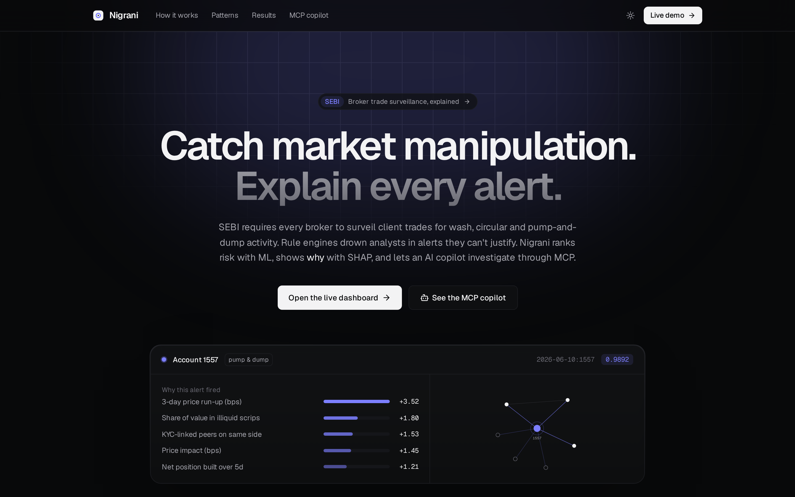
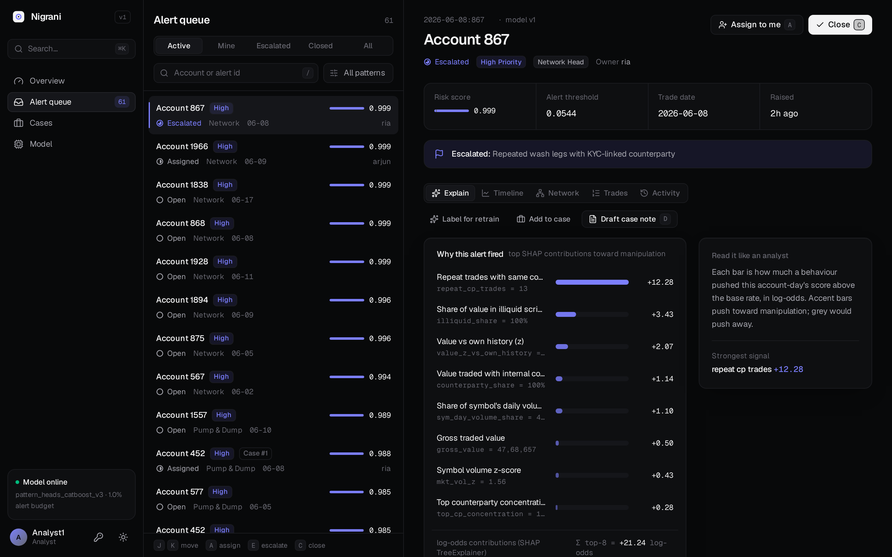
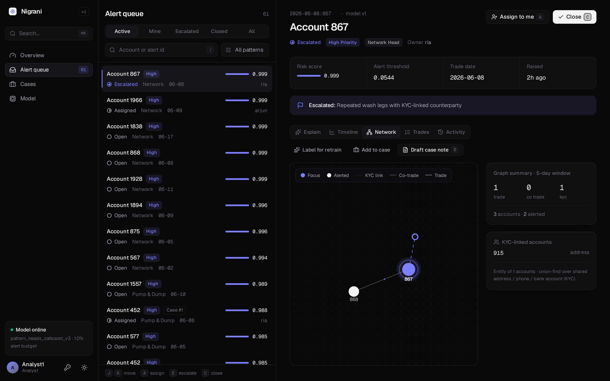
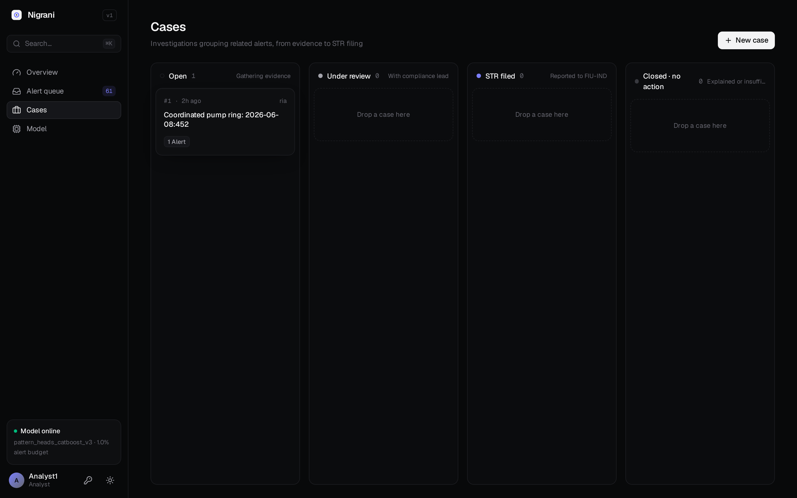
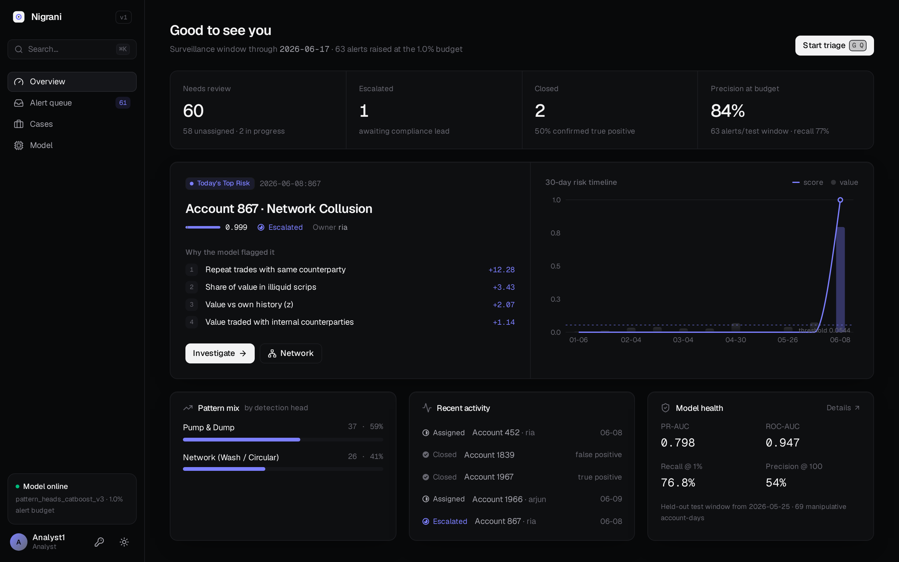
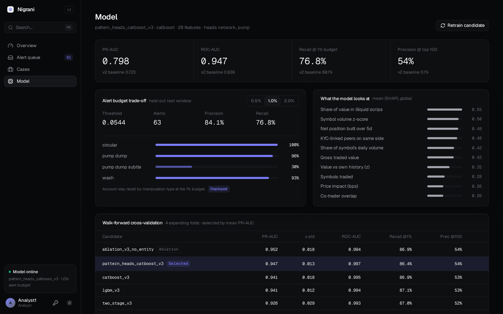
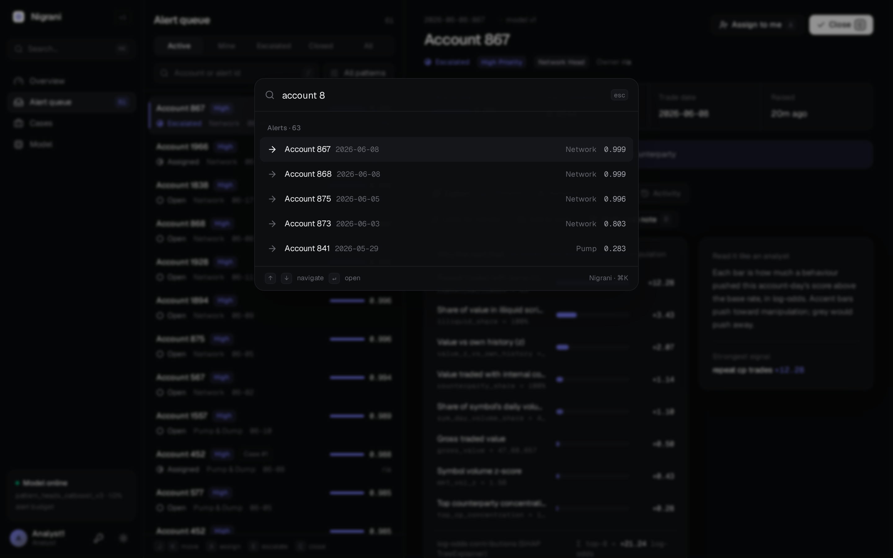
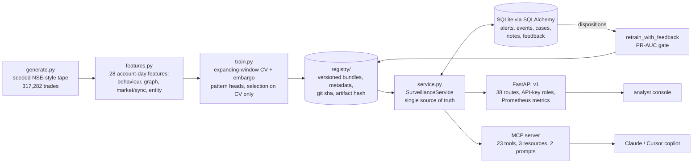

# Nigrani: explainable trade surveillance and AML copilot for a stockbroker

*Nigrani* (निगरानी) means "surveillance". Nigrani scores every **client account-day** for **wash trades, circular rings and pump-and-dump**. It turns the top scores into an **alert queue sized to the desk's review budget** and explains every alert with SHAP. Analysts work the full lifecycle (assign → escalate → close → case → STR decision) through a REST API, a web console, or an **MCP server** from Claude Desktop or Cursor. Their dispositions feed a **gated retraining loop**.

> The model decides the score. The LLM fetches, explains and drafts. A human files.



| Alert queue + SHAP | Account network | Case board |
|---|---|---|
|  |  |  |
| **Overview** | **Model card** | **⌘K palette / light mode** |
|  |  |  |

## Architecture


## Quickstart
```bash
python3 -m venv .venv && .venv/bin/pip install -r requirements.txt
make all     # generate → features → train → sync alerts → tests
make serve   # http://localhost:8000/docs · console: http://localhost:8000/dashboard (key: analyst-dev-key)
make mcp     # MCP server over stdio
make lint    # ruff
```
MCP config for Claude Desktop or Cursor:
```json
{"mcpServers":{"nigrani":{"command":"/ABS/PATH/.venv/bin/python","args":["-m","nigrani.mcp_server"],"cwd":"/ABS/PATH","env":{"NIGRANI_MCP_ACTOR":"copilot"}}}}
```
Configuration comes from environment variables:
- `NIGRANI_DB`: SQLAlchemy URL. Default `sqlite:///artifacts/nigrani.db`.
- `NIGRANI_REGISTRY`: registry path.
- `NIGRANI_API_KEYS`: `key=user:role,...`, where role is `analyst` or `admin`.

## Frontend (`web/`)

Vite + React 19 + TypeScript + Tailwind v4, shadcn-style primitives (Radix + cva), `motion`, lucide, Geist, recharts, react-force-graph, cmdk, sonner. Dark-first with a light toggle and one accent colour. Talks only to the real `/v1` API (key `analyst-dev-key`; `admin-dev-key` for promote/retrain).

- `/` landing page: the SEBI problem, the pipeline, real model-card metrics fetched live, the three patterns, and a real MCP transcript from `docs/mcp_demo.md`.
- `/dashboard` overview (queue stats, today's top risk), `/dashboard/queue` keyboard triage (`j/k`, `/`, `a` assign, `e` escalate, `c` close, `d` draft, `1-5` tabs), `/dashboard/cases` drag-and-drop board, `/dashboard/model`. `⌘K` everywhere, `g o/q/c/m` to navigate. The old page lives at `/dashboard/legacy`.
- `make web-install web-build` writes the build to `nigrani/static/app` (committed), which FastAPI serves. `make web-dev` runs Vite with a `/v1` proxy. `make e2e` runs Playwright end-to-end tests that click every action (assign, escalate, close, reopen, draft, feedback, cases + notes + drag-and-drop, retrain/promote, ⌘K) against a throwaway DB and registry copy. `make shots` regenerates `docs/screens/` with headless Playwright at 1440×900.

## Data and why it's synthetic
Real broker client trades are confidential. The public labelled AML sets (IBM AMLworld, Elliptic) cover bank transfers and Bitcoin, not exchange trades. `generate.py` builds a **seeded** tape instead: 2,000 accounts, 60 symbols, 120 trading days and 317,282 trades. Its typologies follow SEBI enforcement orders.

| Manipulative (label 1) | Legitimate look-alikes (label 0) |
|---|---|
| wash trades between linked accounts (728 trades) | family/HUF crosses (5,638) |
| circular rings of 3–5 accounts (608) | prop-desk / market-maker crosses (6,902) |
| classic pump-and-dump (225) | family rebalancing that forms a cycle (156) |
| **subtle** pump-and-dump: 2–4 accounts, small, mixed with normal flow (183) | news-driven crowd buying of an illiquid scrip (221), block trades (616) |

The data has 48,579 account-days, of which 1.09% are positive. **Label noise:** the model trains on noisy labels (8% of positives missed, 0.2% of negatives mis-tagged). Every metric below uses the true labels.

## Evaluation protocol (no test peeking)
```
dates  = [ ------------- development (85%) ------------- | test (15%, read once) ]
CV     = 4 expanding folds inside development, 5-trading-day embargo before each validation block
select = highest mean CV PR-AUC among eligible candidates (ablations are not eligible)
deploy = refit on development minus last block; alert thresholds = score quantiles on that last block
```

### Cross-validation (mean ± std over 4 folds)
| Candidate | PR-AUC | Recall @1% | Subtle-pump recall @1% |
|---|---|---|---|
| v2 baseline: CatBoost, 17 features | 0.909 ± 0.013 | 0.825 | 0.53 |
| LightGBM, 17 features | 0.886 ± 0.014 | 0.812 | 0.50 |
| CatBoost v3, 28 features | 0.941 ± 0.018 | 0.869 | 0.56 |
| LightGBM v3 | 0.941 ± 0.012 | 0.871 | 0.54 |
| Two-stage (network → pump) | 0.926 ± 0.029 | 0.870 | 0.54 |
| **Pattern heads, CatBoost v3 (selected)** | **0.947 ± 0.013** | 0.864 | 0.56 |
| *ablation: no entity features* | *0.952 ± 0.018* | 0.869 | 0.58 |
| *ablation: no market/sync features* | *0.899 ± 0.010* | 0.798 | 0.40 |

The ablations are an honest finding. The **market and synchronisation features carry the pump gains** (−0.048 PR-AUC without them). The entity-resolution features **did not help** in CV. They stay in because the investigation views use them, but they are a candidate for removal.

### Test set (7,272 account-days, 69 positives): before → after
| Metric | v2 baseline | **v3 selected** |
|---|---|---|
| PR-AUC | 0.723 | **0.799** |
| ROC-AUC | 0.939 | **0.947** |
| Recall at 1% budget | 0.681 | **0.768** |
| Precision@100 | 0.51 | **0.54** |
| Pump-and-dump recall | 0.80 | **0.96** |
| Subtle pump recall | 0.20 | **0.30** |
| Precision at deployed 1% threshold | 0.68 | **0.84** |
| Episodes caught at threshold | 11/12 | **12/12** |

Alert budgets (the thresholds are fixed on the calibration block and then applied to test):

| Budget | Alerts | Precision | Recall |
|---|---|---|---|
| 0.5% | 25 | 1.00 | 0.36 |
| **1.0% (deployed)** | 63 | 0.84 | 0.77 |
| 2.0% | 148 | 0.37 | 0.80 |

**Errors at the 1% threshold:**
- 16 false negatives: 14 subtle pump, 1 pump, 1 wash. Subtle pumps are still the weak spot.
- 10 false positives: 5 normal, 2 prop crosses, 2 news crowds, 1 family ring.

**Drift:** the largest feature PSI is `value_z_vs_own_history` at 0.155, which falls in the "watch" band.

## REST API (`/docs` for OpenAPI)
Every route under `/v1` needs an `X-API-Key`. Analysts can read and work alerts. Only admins can sync alerts, promote models or retrain. Errors use one envelope: `{"error":{"code","message","request_id"}}`. That gives 404 for unknown ids, 409 for an invalid state transition, 401/403 for auth, and 422 for validation. Each request gets an `X-Request-ID` and a JSON log line.

| Area | Routes |
|---|---|
| Ops | `GET /health` · `GET /ready` · `GET /metrics` (Prometheus, latency histogram) · `GET /dashboard` · `GET /v1/me` |
| Scoring | `POST /v1/score` · `POST /v1/score/batch` (≤5,000) · `POST /v1/explain` |
| Alerts | `GET /v1/alerts` (filters: status, pattern, priority, assignee, account, date, min_score; sort; pagination) · `POST /v1/alerts/sync` · `GET /v1/alerts/stats` · `GET /v1/alerts/{id}` · `POST …/assign` · `…/escalate` · `…/close` · `…/reopen` · `…/feedback` · `GET …/case-note-draft` · `GET …/network` |
| Accounts | `GET /v1/accounts/{a}` · `…/linked` · `…/timeline` · `…/network` · `…/trades` |
| Cases | `POST/GET /v1/cases` · `GET/PATCH /v1/cases/{id}` · `POST …/notes` · `POST …/alerts` · `GET …/summary-draft` |
| Model | `GET /v1/model/card` · `GET /v1/model/versions` · `POST /v1/model/promote` · `POST /v1/model/retrain` · `GET /v1/monitoring/drift` · `GET /v1/feedback/stats` |

**Alert lifecycle:**
- `open → assigned → escalated → closed`. A closed alert can be reopened.
- Every transition is written to an audit trail.
- Closing requires a disposition: `true_positive`, `false_positive` or `benign_explained`. The disposition becomes a feedback label.
- `POST /v1/model/retrain` refits the model on the training data plus the feedback labels. The new version is registered **only if calibration-block PR-AUC doesn't fall by more than 0.005**. Promotion is a separate admin step.

## MCP server: 23 tools, 3 resources, 2 prompts
The MCP tools and the REST API call the same `SurveillanceService` methods, so the copilot can't produce a score that the model didn't. Domain errors come back to the model as typed tool errors (`not_found`, `invalid_transition`, `bad_request`).

The 23 tools, by area:
- **Alerts:** `list_alerts`, `get_alert`, `explain_alert`, `assign_alert`, `escalate_alert`, `close_alert`, `record_feedback`, `draft_case_note`, `queue_stats`, `sync_alerts`
- **Investigation:** `get_account_timeline`, `get_counterparty_network`, `get_linked_accounts`, `get_account_trades`
- **Cases:** `create_case`, `list_cases`, `get_case`, `add_case_note`, `update_case_status`
- **Model:** `score_account_day`, `model_card`, `model_versions`, `drift_report`

The server also has these resources and prompts:
- **Resources:** `nigrani://model-card`, `nigrani://alerts/{alert_id}`, `nigrani://cases/{case_id}`
- **Prompts:** `triage_alert`, `weekly_summary`

A recorded real stdio session (temp DB, copied registry) is in [`docs/mcp_demo.md`](docs/mcp_demo.md). Regenerate it with `python docs/mcp_demo.py`.

## Quality
- **Tests:** 47 tests, run with `make test`.
  - Service: lifecycle, invalid transitions, cases, network, drift, retrain gate.
  - API: every route, auth and roles, error envelope, metrics.
  - MCP: a stdio end-to-end session through a real client, plus in-process calls.
  - Pipeline: a small generate → features → train run.
- **Coverage:** **94%** line coverage. CI fails under 85%. `train.py` is at 60% because the full CV run is too slow for unit tests; the pipeline test covers a reduced run.
- **Linting and types:** ruff is clean, and the code has type hints throughout.
- **CI:** the workflow is in `ci/github-actions-ci.yml`. Copy it to `.github/workflows/` to enable it.

## Design decisions
- **The account-day is the unit**, not the trade. Analysts review clients, and manipulation is a pattern across trades.
- **Expanding-window CV with an embargo**, never a random split. Rolling features use only past data.
- **PR-AUC and recall at an alert budget**, not accuracy. At 1% prevalence accuracy is meaningless, and the desk has fixed review capacity.
- **Pattern heads.** Separate network (wash/circular) and pump heads; the alert score is the max. The higher head sets the alert's pattern.
- **Retraining is gated and promotion is separate.** A feedback label never silently ships a worse model.

## Limitations
- The data is **synthetic**. The numbers show the method works, not production performance.
- The test set has 69 positives, so differences of about 0.03 PR-AUC are within noise.
- No order-book data, so spoofing and layering aren't covered. Subtle-pump recall is still only 0.30.
- The retrained version's test metrics are marked "not re-evaluated". Test is read once.
- SQLite is used for the demo. The SQLAlchemy layer is Postgres-ready but hasn't been tested on Postgres.
- The Dockerfile has not been built here (no Docker daemon). There's no GNN benchmark yet.

## Repo
```
nigrani/  generate.py features.py models.py registry.py train.py db.py service.py schemas.py api.py mcp_server.py static/dashboard.html
tests/    conftest.py test_service.py test_api.py test_mcp.py test_pipeline.py
reports/  metrics.json pr_curves.png shap_importance.png
docs/     dashboard_alerts.png mcp_demo.md mcp_demo.py
ci/github-actions-ci.yml · Dockerfile · Makefile · pyproject.toml
```
